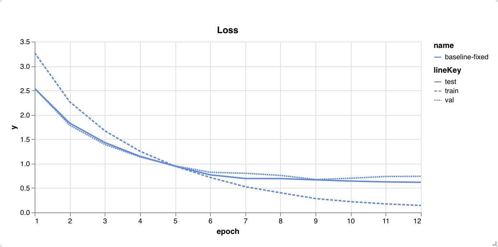
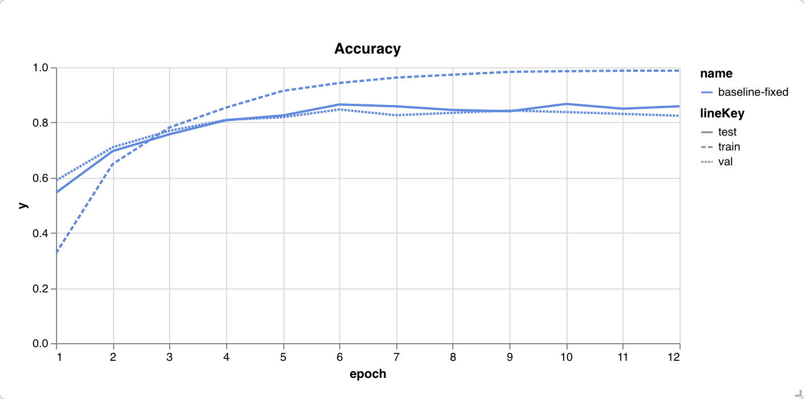
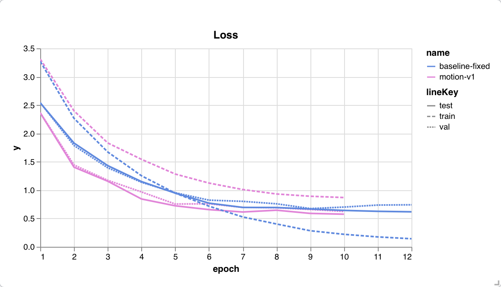
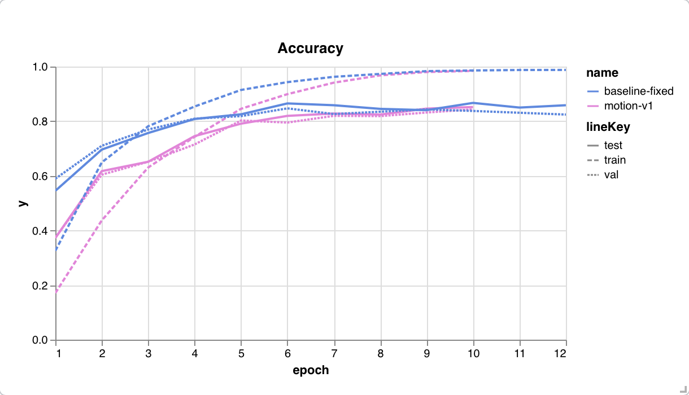
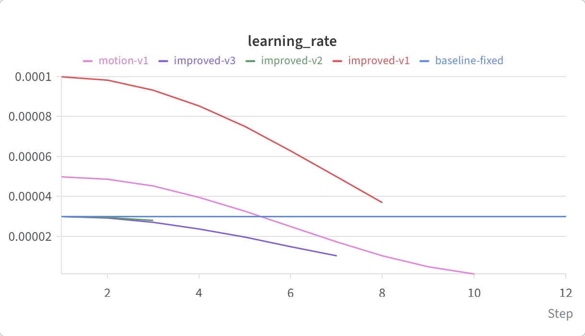

# Video Action Recognition on UCF50 with LRCN
 
This project classifies human actions in short videos from the UCF50 dataset (50 actions, 6,681 clips). It uses a Long-term Recurrent Convolutional Network (LRCN): a ResNet reads each frame, an LSTM reads the frame features in order, and a final layer predicts the action. The starter code had a serious bug and a data leak, which were fixed with this update. Additionally, Weights & Biases logging and unit tests were added, and the model performance was improved. The final result (93.45% test accuracy) blends two LRCN models: one that looks at pictures and one that looks at motion. The project includes scripts for preprocessing, training, testing, and blending the models.

---
 
## Table of Contents
 
- [Results](#results)
- [Errors Found and Fixed](#errors-found-and-fixed)
- [Improvements](#improvements)
- [Experiment Log](#experiment-log)
- [Weights & Biases](#weights--biases)
- [Dataset Preparation](#dataset-preparation)
- [Environment Setup](#environment-setup)
- [Preprocessing and Frame Extraction](#preprocessing-and-frame-extraction)
- [Training the Models](#training-the-models)
- [Testing and Evaluation](#testing-and-evaluation)
- [Unit Tests and Linting](#unit-tests-and-linting)
- [Project Structure](#project-structure)
- [Customization and Hyperparameters](#customization-and-hyperparameters)
- [Limitations](#limitations)

---

## Results
 
All accuracies are on videos from groups the model never saw during training.
 
| Model | Validation | Test |
|---|---|---|
| Baseline (bugs and leak fixed, ResNet34 + LSTM) | 84.70% | 86.51% |
| Picture model (ResNet50 + LSTM, improved) | 88.95% | 88.03% |
| Motion model (frame differences, ResNet34 + LSTM) | 83.95% | 85.85% |
| **Blend of picture and motion models (60% / 40%)** | **90.75%** | **93.45%** |
 
- The blend weight was chosen on the validation set only. The test set did not influence it.
- The picture and motion rows use mirror averaging at test time (explained below). The baseline does not.
- The test set has about 1,050 videos. Beating 93% by 0.45 points is about 5 videos. The margin is small.

---

### How the Blend Works
 
Each trained model gives a probability for each of the 50 actions for every video. `fuse.py` mixes them with one weight:
 
`blended probability = weight × picture model + (1 − weight) × motion model`
 
The weight is the share of trust given to the picture model. A weight of 0.6 means 60% of the decision comes from the picture model and 40% from the motion model. A weight of 0 uses only the motion model, and a weight of 1 uses only the picture model. The action with the highest blended probability is the prediction.
 
Example for one video with a weight of 0.6:
 
| Action | Picture model | Motion model | Blended |
|---|---|---|---|
| Diving | 80% | 40% | 0.6 × 80 + 0.4 × 40 = 64% |
| Swing | 20% | 60% | 0.6 × 20 + 0.4 × 60 = 36% |
 
The blend predicts Diving.
 
I tried weights from 0 to 1 in steps of 0.05 (21 options) and measured accuracy on the validation videos only. The best weight was 0.6, which was applied once to the test videos, producing test accuracy of 93.45%.
 
---
 
## Errors Found and Fixed
 
| # | Problem in the starter code | Fix |
|---|---|---|
| 1 | **Significant bug.** The LSTM had no `batch_first=True`, and frames were fed one at a time. The LSTM treated the videos in a batch as time steps of one sequence. Videos affected each other, and a prediction depended on the other videos in its batch. | Added `batch_first=True`. All frames go through the CNN together and are reshaped to (batch, time, features). A test checks that a video gives the same output alone or inside a batch. |
| 2 | **Data leak.** Clips were split randomly one by one. Clips from the same UCF50 group (`g01` to `g25`) show the same people and scenes. Near duplicates of test clips were in the training set. | Split by group: 1 to 17 train, 18 to 21 validation, 22 to 25 test. The code raises an error if groups overlap, and a test checks it. |
| 3 | `--cnn_backbone resnet152` silently loaded ResNet34. | Each name loads the matching model. Unknown names raise an error. |
| 4 | `--pretrained False` was read as the string "False", which counts as true. | Added `--pretrained` and `--no-pretrained` flags. |
| 5 | Asking for 16 frames returned 17. | Returns exactly the requested number. |
| 6 | Frames were read in arbitrary order, and file names were not zero padded. | Frames are saved as `frame_000.jpg` and read in sorted order. |
| 7 | Random augmentation was applied to each frame separately. Clips flickered. | One random flip or crop is applied to the whole clip. |
| 8 | The epoch loss averaged batch averages, which overweights a small last batch. | Each batch loss is weighted by its size. |
| 9 | Cleanup: the README described HMDB51, `run_training.py` duplicated `run.py`, an unused `collate_fn_r3d_18` was left in, `.DS_Store` files counted as classes, and only CUDA was detected. | README rewritten, duplicate and unused code removed, only folders count as classes, Apple MPS supported. |
 
The test set never picks the best checkpoint or changes the learning rate. The best checkpoint is chosen by validation accuracy. Test accuracy is logged each epoch only for the curves.

---
 
## Improvements
 
These were developed together, and this project does not measure how much each one helps alone.
 
1. **Better fine tuning.** ResNet50 replaces ResNet34. AdamW adds weight decay. The pretrained CNN uses a small learning rate (3e-5) and the new LSTM and final layer use a larger one (3e-4). A cosine schedule lowers the learning rate smoothly.
2. **Regularization.** The baseline's training loss kept falling (0.72 at epoch 6, 0.14 at epoch 12) while validation accuracy stayed near 83 to 84%, which suggests memorizing. I added label smoothing (0.1), dropout 0.3, mean pooling over all LSTM outputs, and *temporal jitter*. Temporal jitter stores 32 frames per video and picks a different random frame from each of 16 time segments every epoch. Validation and test always use the same evenly spaced frames.
3. **A motion stream.** The LRCN paper (Donahue et al., 2015) combines a model on RGB frames with a model on optical flow. A per class check on validation showed most picture model errors were actions defined by movement. Optical flow is slow to compute for 6,681 videos. I used a cheaper stand in: for 16 positions per video I store a frame and the frame 4 frames later, and the motion model sees their difference. Still objects turn to zero and movement remains. The two models are trained separately and blended by `fuse.py`.
4. **Mirror averaging at test time.** Each test clip is also shown flipped left to right, and the two sets of scores are averaged.

---

## Experiment Log
 
| Run | What changed | Outcome |
|---|---|---|
| `baseline-fixed` (`train.sh`) | ResNet34, last LSTM output, Adam, 12 epochs | Best validation 84.70% at epoch 6. Test 86.51%. |
| `improved-v1` (script removed) | AdamW, cosine schedule, strong crops and color jitter, label smoothing, dropout 0.5, mean pooling | Learned too slowly. Stopped at epoch 8 with validation 65.5%. Too much regularization at once. |
| `improved-v2` (script removed) | v1 without strong crops, dropout 0.3, lower learning rate | Stopped at epoch 3 because it was not clearly ahead of the baseline. |
| `improved-v3` (`train_improved_v3.sh`) | ResNet50, hidden size 256, temporal jitter, mean pooling, label smoothing | Stopped after epoch 6 of 10 to save time. The epoch 6 checkpoint is the picture model (validation 88.76%, 88.95% with mirror averaging). |
| `motion-v1` (`train_motion.sh`) | Same design on frame differences, ResNet34, 10 epochs | Validation 83.95%, test 85.85% (with mirror averaging). |
| `blend-final` (`eval_fuse.sh`) | `fuse.py` blends the two models | Validation 90.75%, test 93.45%. |
 
**Note on the test score.** Per the assignment requirement, training, validation, and test curves were reported for each epoch. For some of the models, decisions were made before the last epoch. I based those decisions on validation accuracy, but the test numbers were visible at the time, which means the final test score may be slightly optimistic.
 
---

## Weights & Biases

Training logs loss and accuracy for train, validation, and test every epoch, plus the learning rate.

- Project: https://forge.coreweave.com/wandb/jeannkwonn-johns-hopkins-university/ucf50-action-recognition?nw=nwuserjeannkwonn
- Baseline run: `baseline-fixed`. The final blend is logged as `blend-final`.

Run `wandb login` once before the first training run. Add `--no-wandb` to turn logging off.

### Baseline Charts




### All Runs Compared




 
---

## Dataset Preparation
 
### Step 0: Download and Unzip Dataset
 
Download UCF50 from [UCF](https://www.crcv.ucf.edu/data/UCF50.php) and unzip it into `../ucf50-data/UCF50`. The folder structure should be:
 
```
ucf50-data
    UCF50
        BaseballPitch
            v_BaseballPitch_g01_c01.avi
            ...
        (50 action folders)
```
 
Each subfolder is one action class. In a clip name such as `v_BaseballPitch_g01_c01`, `g01` is the group number used for the split.
 
---
 
## Environment Setup
 
Python 3.9 or higher is recommended. I used Python 3.13 on a Mac.
 
```bash
python -m venv .venv
source .venv/bin/activate
pip install -r requirements.txt
```
 
Key libraries: PyTorch, torchvision, OpenCV, scikit-learn, tqdm, numpy, Pillow, wandb, pytest, and pylint.
 
A GPU is not required. The code picks CUDA, then Apple MPS, then CPU. The ResNet34 baseline took about 12 minutes per epoch on an Apple M series laptop.
 
---
 
## Preprocessing and Frame Extraction
 
Videos must be converted to frames before training through `preprocess.py`. Three versions are used:
 
```bash
# 16 frames per video (baseline)
python preprocess.py --video_dir ../ucf50-data/UCF50 --frame_dir ../ucf50-data/ucf50_frames --n_frames 16
# 32 frames per video (picture model, for temporal jitter)
python preprocess.py --video_dir ../ucf50-data/UCF50 --frame_dir ../ucf50-data/ucf50_frames32 --n_frames 32
# 16 pairs of frames 4 apart (motion model)
python preprocess.py --video_dir ../ucf50-data/UCF50 --frame_dir ../ucf50-data/ucf50_pairs --n_frames 16 --pair_gap 4
```
 
The script skips videos that are already done and is safe to run again.
 
---

## Training the Models
 
Each run saves its best checkpoint to `./models/best_model_wts.pt`. Rename the folder after each run so the next run does not overwrite it.
 
```bash
bash train.sh                  # baseline
mv models models_baseline
 
bash train_improved_v3.sh      # picture model (I stopped it after epoch 6)
mv models models_v3_partial
 
bash train_motion.sh           # motion model
mv models models_motion
```
 
During training the script:
- Loads the frames and splits them by group (train 1 to 17, validation 18 to 21, test 22 to 25).
- Applies augmentation to whole clips (resize, random flip, small random shift).
- Trains the LRCN, logs to W&B, and saves the best weights by validation accuracy.

Update `--frame_dir` in the scripts if your data is somewhere else.
 
---
 
## Testing and Evaluation
 
```bash
bash test.sh        # baseline on the test set (expect 86.51%)
bash eval_fuse.sh   # scores both models, blends them, logs to W&B (expect 90.75% val and 93.45% test)
```
 
`eval_fuse.sh` saves each model's probabilities to `.npz` files, then `fuse.py` picks the blend weight on validation and applies it to the test set.
 
For a closer look, add `--report` to an eval command. It prints accuracy per group, the weakest classes, and the most common mistakes. `eval_v3.sh` shows an example.
 
---
 
## Unit Tests and Linting

```bash
pytest                       # 50 unit tests
pylint *.py tests/*.py       # 10.00/10 with the settings in .pylintrc
```

Saved outputs from my runs: [pytest](logs/pytest_output.txt) and [pylint](logs/pylint_output.txt).

The tests use tiny fake data and need no dataset. They cover the group parsing and split (no overlap), frame sorting and sampling, the transforms, the model (output shape, videos in a batch do not affect each other), the loss averaging, the training loop, evaluation, mirror averaging, and blending.
 
---
 
## Project Structure
 
| File | Purpose |
|---|---|
| `preprocess.py` | Turns videos into folders of frames or frame pairs |
| `video_datasets.py` | Dataset class, group split, collate function |
| `models.py` | The LRCN model |
| `utils.py` | Frame extraction, transforms, data loaders |
| `train.py` | Training loop |
| `evaluate.py` | Scoring, per class accuracy, common mistakes |
| `run.py` | Command line entry point for training and evaluation |
| `fuse.py` | Blends two models and logs the result |
| `tests/` | Unit tests |
| `train.sh`, `train_improved_v3.sh`, `train_motion.sh` | Training commands |
| `test.sh`, `eval_v3.sh`, `eval_fuse.sh` | Evaluation commands |
 
---

## Customization and Hyperparameters
 
Run `python run.py --help` for all options. The main ones:
 
### Data

- `--frame_dir`: path to the extracted frames.
- `--val_groups` and `--test_groups`: which UCF50 groups go to validation and test.
- `--fr_per_vid`: frames per video.
- `--temporal_jitter`: random frame from each time segment during training.
- `--frame_diff`: use frame differences (motion model).

### Model

- `--cnn_backbone`: `resnet18`, `resnet34`, `resnet50`, `resnet101`, or `resnet152`.
- `--rnn_hidden_size` and `--rnn_n_layers`: size of the LSTM.
- `--temporal_pool`: `last` or `mean` LSTM output.
- `--dropout`.

### Training

- `--batch_size`, `--n_epochs`, `--learning_rate`, and `--head_lr`.
- `--weight_decay`, `--label_smoothing`, and `--scheduler` (`plateau` or `cosine`).
- `--tta`: mirror averaging at test time.

---
 
## Limitations
 
- Each model was trained once with no fixed seed. A rerun will land close to these numbers but not exactly reproduce them.
- The picture model was stopped at epoch 6 of 10.
- The improvements were combined. I did not measure each one alone.
- Model weights are not in this repository because of their size.

---
 
## Reference
 
J. Donahue et al., *Long-term Recurrent Convolutional Networks for Visual Recognition and Description*, CVPR 2015.
